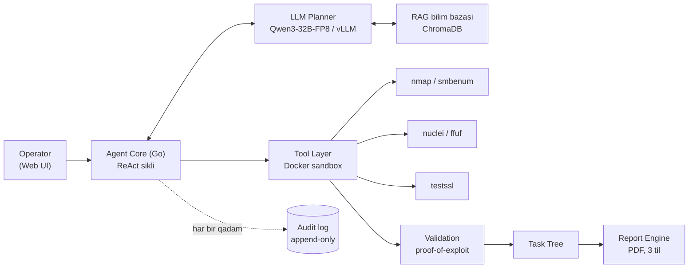

# shumbola.ai — loyiha hisoboti

**Sana:** 2026-08-13
**Repozitoriy:** shumbola (Go + React/TypeScript)
**Holat:** Bosqich 4 — MVP'ga tayyorgarlik

To'liq talablar uchun [shumbola_ai_TZ.md](shumbola_ai_TZ.md) hujjatiga qarang.

---

## 1. Qisqacha xulosa

shumbola.ai — operator (pentester) nazorati ostida ishlaydigan AI agent: u scope ichidagi nishonlarni razvedka qiladi, standart ochiq tool'lar (`nmap`, `nuclei`, `ffuf`, `testssl`, `smbenum`) orqali zaifliklarni qidiradi, har bir topilmani "buzmasdan tasdiqlash" (proof-of-exploit) mezoniga tekshiradi va natijada standartlarga (OWASP/MITRE/CVSS) bog'langan, uch tilli PDF report yaratadi. Har bir aktiv/intruziv harakat operatorning aniq tasdig'idan (HITL) o'tadi, istalgan vaqtda "kill switch" bilan to'xtatiladi, va har bir qadam o'zgartirilmaydigan (append-only) audit logga yoziladi.

Backend — Go tilida (`services/agent-core`), tool'lar Docker konteynerlarida izolyatsiyalangan holda ishlaydi. Fikrlash qatlami (Agent Core) real LLM — **Qwen3-32B-FP8** (foydalanuvchining o'z GPU serverida, vLLM orqali) va RAG bilim bazasi (pentest metodologiyasi, OWASP/PayloadsAllTheThings va h.k.) bilan ishlaydi. Operator paneli — React/TypeScript'da qurilgan, qorong'i "security console" uslubidagi Web UI.

**Asosiy raqamlar:**

| | |
|---|---|
| Bosqich to'liq/qisman tayyor | 4/6 |
| Ishlaydigan pentest tool | 5 |
| Go paketi (testlar bilan) | 14 |
| Commit (TZ bosqichlari bo'yicha) | 8 |

---

## 2. Arxitektura

Operator scope belgilaydi → Agent Core (ReAct sikli) keyingi qadamni tanlaydi → Tool Layer uni Docker'da bajaradi → Validation qatlami "proof-of-exploit" mezoni bilan tekshiradi → Task Tree'ga yoziladi → Report Engine yakuniy hujjatni tayyorlaydi. Har bir bosqich Audit log'ga yoziladi.

---

## 3. Bosqichlar bo'yicha progress (TZ 10-bo'lim)

### Bosqich 0 — Poydevor ✅ Tayyor
Repo skeleti, Docker Compose, o'zgartirilmaydigan (hash-chained) audit log, RBAC/autentifikatsiya (Operator/Administrator/Auditor), Docker sandbox skeleti, CI.

### Bosqich 1 — Agent yadrosi ✅ Tayyor
ReAct sikli (`agentcore.Engine`), Task Tree, HITL tasdiqlash gate'i, kill switch, engagement'lar uchun to'liq HTTP API. Boshida oddiy, deterministik `StaticPlanner` bilan ishlagan (hali real LLM ulanmagan edi).

### Bosqich 2 — Tool va validatsiya ✅ Tayyor
Tool qatlami kengaytirildi (`nmap`, `nuclei`, `ffuf`, `testssl`, `smbenum`), scope allowlist majburlandi, qoida-asosidagi proof-of-exploit/ishonch bahosi qo'shildi.

### Bosqich 3 — Report va til ✅ Tayyor
PDF report engine, OWASP/MITRE/CVSS'ga heuristik xaritalash, uch tilli shablonlar (o'zbek lotin, o'zbek kirill, rus). Faqat tasdiqlangan (proven) topilmalar reportga chiqadi.

### Bosqich 4 — Moslashtirish va sinov 🟡 Qisman
RAG bilim bazasi ✓, real LLM (Qwen3-32B) ✓, Web UI ✓, ichki test muhitida sinov ✓ (DVWA, Samba konteynerlari bilan). **LoRA fine-tune hali boshlanmagan** — TZ tavsiyasi, lekin RAG allaqachon ko'p narsani qoplagani sababli MVP'dan keyingi versiyaga qoldirish tavsiya etildi.

### Bosqich 5 — Pilot ⏳ Kutilmoqda
Nazorat qilinadigan mijoz muhitida (test/staging) pilot ishga tushirish, fikr-mulohaza asosida takomillashtirish.

---

## 4. LLM va RAG

**Model:** `Qwen/Qwen3-32B-FP8`, foydalanuvchining o'z serverida (2×RTX 4090, 24GB×2), `vllm/vllm-openai:v0.8.5` orqali tensor-parallel rejimda serve qilinadi (`--tensor-parallel-size 2 --max-num-seqs 32 --enable-reasoning --reasoning-parser deepseek_r1`). Model "fikrlash" (thinking mode) rejimida ishlaydi va guided-JSON orqali qat'iy formatda javob beradi.

**RAG bilim bazasi:** ChromaDB + fastembed (`paraphrase-multilingual-MiniLM-L12-v2`), 7760 ta bo'lak (chunk) — OWASP WSTG, HackTricks, PayloadsAllTheThings, OWASP Top10/API Security va Cheat Sheet Series'dan tayyorlangan. `LLMPlanner` har bir qarorni shu bilim bazasidan olingan tegishli parchalar bilan asoslaydi.

Integratsiya jarayonida uchta real xato aniqlanib tuzatildi:
1. `deepseek_r1` parser + guided-JSON birgalikda ishlatilganda javob `content` emas, `reasoning_content` maydoniga tushib qolar edi.
2. JSON sxemasi model `tool`/`target`ni bo'sh qoldirib `done: false` deb javob berishiga yo'l qo'yardi.
3. 120 soniyalik HTTP timeout uzun fikrlash javoblari uchun yetarli emas edi (5 daqiqaga oshirildi).

---

## 5. Web UI

React 19 + TypeScript + Vite asosida qurilgan: kirish, engagement yaratish/ro'yxati, engagement tafsilotlari sahifasi (holat, scope, Start/Stop, real-vaqtli Task Tree va HITL tasdiqlash paneli — pollingga asoslangan, chunki backend'da websocket yo'q), va til/format tanlab PDF report yuklab olish. Backend tarafida buning uchun `GET /engagements` (ro'yxat) va CORS middleware qo'shildi.

Keyinroq butun UI qorong'i, "security console" uslubida qayta dizayn qilindi: maxsus rang tokenlari, monospace texnik ma'lumotlar (ID, sana, holat), status va severity uchun rangli belgilar, inline SVG ikonlar (tashqi paketsiz), va haqiqiy ota-bola ierarxiyasida ko'rsatiladigan Task Tree.

---

## 6. So'nggi sessiya: real muhitda sinov va topilgan xatolar

Web UI tayyor bo'lgach, tizim haqiqiy Docker konteynerlari (DVWA, Samba), haqiqiy LLM va real tashqi nishonlarga qarshi sinovdan o'tkazildi. Bu — fake/mock testlar hech qachon aniqlay olmaydigan bir qancha real xatoni ochib berdi.

| # | Joy | Muammo | Yechim |
|---|---|---|---|
| 1 | `tools/*.go` | `nmap`, `nuclei`, `ffuf` buyruqlarida tool nomi ikki marta ko'rsatilgan edi (image ENTRYPOINT'i allaqachon shu tool bo'lsa-da) | Ortiqcha birinchi argument olib tashlandi |
| 2 | sandbox | `nuclei`/`ffuf`/`testssl` read-only fayl tizimida ishlay olmasdi (konfiguratsiya/vaqtinchalik fayl yozishga urinadi) | Shu uch tool uchun `ReadOnlyFS: false` |
| 3 | ffuf | Standart image (`ghcr.io/ffuf/ffuf`) ochiq emas edi; muqobil image'da `-o -` ishlamas, JSON progress-bar shovqini bilan buzilardi | O'z image'imiz qurildi, `-o /dev/stdout`ga o'tildi, parser shovqinni kesadi |
| 4 | `agentcore.Engine` | Backend qayta ishga tushirilganda "running" engagement'larni kill switch to'xtata olmasdi (fon jarayoni yo'qolgan) | Fon jarayoni topilmasa, holat majburan "to'xtatildi"ga o'tkaziladi |
| 5 | `agentcore.Engine` | Kill switch LLM javobini kutayotganda bosilsa, holat noto'g'ri "xato"ga o'zgarardi | Bu holat ham to'g'ri "to'xtatildi" deb yoziladi |
| 6 | `agentcore.Engine` | LLM promptdagi ko'rsatmaga qaramay bir xil qadamni cheksiz takrorlashi mumkin edi | Kodda qat'iy taqiqlandi — 3 marta takrorlansa avtomatik yakunlanadi |
| 7 | `engagement.New` | To'liq URL (`https://sayt.uz/sahifa`) kiritilsa, `nmap` "0 host skanerlandi" deb xatosiz tugab, "topilma yo'q" deb noto'g'ri yozardi | Scope qabul qilinganda avtomatik toza host[:port]ga tozalanadi |
| 8 | `httpserver` | Engagement ikki marta ishga tushirilsa (`/start` tekshiruvsiz), ikkita parallel jarayon to'qnashardi | Allaqachon ishlayotgan engagement'ni qayta ishga tushirish rad etiladi (409) |
| 9 | sandbox / tools | Konteyner ichida domen nomi hal qilinishi ishonchsiz edi; yaxshi himoyalangan (WAF/rate-limit) nishonlarda `nmap` cheksiz kutib qolishi mumkin edi | Domen host resolveri orqali oldindan hal qilinib `/etc/hosts` orqali uzatiladi; har bir tool chaqiruvi uchun 5 daqiqalik ijro muddati qo'shildi |

---

## 7. Joriy holat — MVP qabul qilish mezonlari (TZ 11-bo'lim)

| # | Mezon | Holat |
|---|---|---|
| 1 | Operator security key bilan kiradi, engagement yaratadi va scope belgilaydi | ✅ Bajarildi |
| 2 | Agent scope ichida razvedka/tekshiruv o'tkazadi; scope'dan chiqmaydi | ✅ Bajarildi |
| 3 | Har bir intruziv harakat HITL'dan o'tadi; kill switch ishlaydi | ✅ Bajarildi |
| 4 | Topilmalar validatsiyadan o'tadi; asossizlari filtrlanadi | ✅ Bajarildi |
| 5 | Standartlarga bog'langan, tanlangan tildagi report avtomatik yaratiladi | ✅ Bajarildi |
| 6 | Barcha harakatlar audit logga to'liq yoziladi | ✅ Bajarildi |
| 7 | Tizim mijoz serveriga offline o'rnatila oladi | ⏳ Tekshirilmagan |

---

## 8. Keyingi qadamlar

- **Tool kengaytirish** — TZ tavsiya qilgan `nikto`, `wpscan`, `sqlmap` (read-only). `masscan` sinovdan o'tkazildi, lekin Docker Desktop/WSL2'ning raw-socket cheklovi sababli hozircha qo'shilmadi.
- **Offline deploy tekshiruvi** — docker-compose orqali butun tizimni internetsiz, mijoz serveriga o'xshash muhitda oxirigacha sinash (MVP mezoni #7).
- **LoRA fine-tune** — kamida ~500 sifatli namuna kerak (holat → to'g'ri qaror juftliklari). Ataylab MVP'dan keyinga qoldirilgan — RAG allaqachon ko'p narsani qoplaydi.
- **Xavfsizlik ko'rib chiqish** — pilot bosqichiga o'tishdan oldin butun kod bazasini xavfsizlik nuqtai nazaridan audit qilish.

---

## 9. Repo tarixi — commit'lar

| Hash | Xabar |
|---|---|
| `935b638` | Web UI qayta dizayni, smbenum tool va real muhitda topilgan xatolarni tuzatish |
| `165081d` | Web UI: operator paneli — engagement boshqaruvi, HITL, real-vaqtli kuzatuv, report |
| `fcbe75d` | Bosqich 4: RAG bilim bazasini LLMPlanner'ga ulash |
| `829ca47` | Bosqich 4: LLMPlanner — Qwen3-32B-FP8 modelini ReAct siklga ulash |
| `4ef1447` | Bosqich 3: PDF report engine, OWASP/MITRE/CVSS xaritalash, uch tilli shablonlar |
| `66c839b` | Bosqich 2: nuclei/ffuf/testssl tool'lari va proof-of-exploit validatsiya qatlami |
| `619fd18` | Bosqich 1: ReAct sikli, Task Tree, nmap tool, HITL gate, kill switch |
| `a51b0f9` | Bosqich 0: repo skeleti, audit log, RBAC/auth, sandbox, CI |
