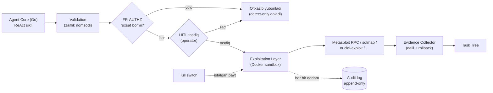

# shumbola.ai — Ekspluatatsiya bosqichi TZ (Offensive Extension)

**Versiya:** 1.0 (loyiha)
**Sana:** 2026-08-13
**Bog'liq hujjatlar:** `shumbola_ai_TZ.md` (asosiy TZ), `LOYIHA_HISOBOTI.md`
**Holat:** Bosqich 4 tugagach rejalashtirilgan kengaytirish

---

## 0. Bu hujjat nima haqida (va nima haqida EMAS)

Hozirgi `shumbola` — razvedka + zaiflik **aniqlash** agenti: topadi, "buzmasdan tasdiqlaydi" (proof-of-exploit), report qiladi. Bu TZ uni **avtorizatsiyalangan ekspluatatsiya** (validated exploitation) qila oladigan red-team platformasiga kengaytiradi — ya'ni mijoz roziligi bilan, aniq belgilangan doirada, topilgan zaiflikni *nazorat ostida* amalda tasdiqlash.

**Bu — EMAS:**
- Avtonom hujum quroli emas. Har bir ekspluatatsiya harakati operator tasdig'idan (HITL) o'tadi.
- Scope'siz ishlaydigan tizim emas. Avtorizatsiyasiz nishonga bironta ham paket yuborilmaydi.
- Yangi 0-day yozadigan yoki malware ishlab chiqaradigan mashina emas. Faqat mavjud, tekshirilgan, ochiq tool'larni (Metasploit, sqlmap va h.k.) nazorat qatlami ostida orkestratsiya qiladi.

**Asosiy tamoyil:** ekspluatatsiya imkoniyati oshgani sari nazorat qatlamlari **kuchayadi**. Nazoratni o'chirib bo'lmaydi — bu arxitekturaga "hard requirement" sifatida qotiriladi (FR-SAFE bo'limi).

---

## 1. Maqsad va biznes-asos

Aniqlash-only pentest reporti mijozga ko'pincha yetarli emas: "bu URL'da SQLi bor bo'lishi mumkin" degan topilma "bu URL'da SQLi bor va u orqali `users` jadvalini o'qib bo'ldi" degan tasdiqdan zaifroq. Avtorizatsiyalangan ekspluatatsiya:

- **False-positive'ni yo'q qiladi** — faqat amalda tasdiqlangan zaiflik reportga chiqadi.
- **Ta'sir (impact) ni real ko'rsatadi** — mijoz remediation prioritetini to'g'ri qo'yadi.
- **Tijoriy qiymatni oshiradi** — bu red-team mahsulotlarining standart talabi.

---

## 2. Doira (Scope) va cheklovlar

### 2.1. Kirish doirasi (in-scope)
- Mavjud ochiq ekspluatatsiya freymvorklarini integratsiya qilish (FR-EXPLOIT).
- Ekspluatatsiya harakatlarini mavjud HITL/scope/audit qatlami ostiga joylashtirish.
- "Blast radius" (ta'sir doirasi) cheklovlari, dry-run rejimi, rollback.
- Ekspluatatsiya dalillarini (evidence) report engine'ga ulash.

### 2.2. Doiradan tashqari (out-of-scope, ataylab)
- Destruktiv harakatlar (ma'lumot o'chirish, DoS, ransomware-simulyatsiya) — **standart taqiqlangan**, alohida yozma ruxsatsiz umuman yo'q.
- Lateral movement / persistence (backdoor qoldirish) — MVP'da yo'q; keyingi versiyalarda faqat aniq RoE bilan ko'rib chiqiladi.
- Ijtimoiy injeneriya / phishing infratuzilmasi — bu loyiha doirasida emas.
- Yangi ekspluat/payload *ishlab chiqish* — platforma faqat mavjud, tekshirilgan modullarni ishlatadi.

---

## 3. Avtorizatsiya va huquqiy ramka (FR-AUTHZ) — eng muhim bo'lim

Ekspluatatsiya qo'shilgani uchun bu qatlam yangi va **majburiy**. Bularsiz ekspluatatsiya modullari umuman ishga tushmasligi kerak (fail-closed).

| ID | Talab |
|---|---|
| FR-AUTHZ-1 | Har bir engagement uchun **imzolangan Rules of Engagement (RoE)** hujjati tizimga yuklanmaguncha ekspluatatsiya rejimi (`mode: exploit`) yoqilmaydi. RoE — sana oralig'i, ruxsat etilgan doira, ta'qiqlangan harakatlar, aloqa ro'yxatini o'z ichiga oladi. |
| FR-AUTHZ-2 | Scope allowlist'ga har bir nishon uchun **avtorizatsiya turi** biriktiriladi: `recon-only` / `detect-only` / `exploit-allowed`. Ekspluatatsiya faqat `exploit-allowed` nishonlarda mumkin. |
| FR-AUTHZ-3 | Ekspluatatsiya harakati boshlanishidan oldin tizim RoE'ning **amal qilish oynasini** (vaqt/sana) tekshiradi. Oynadan tashqarida — rad etiladi. |
| FR-AUTHZ-4 | Avtorizatsiya ma'lumotnomasi (RoE ID, kim tasdiqladi, qachon) har bir ekspluatatsiya yozuviga audit log'da biriktiriladi. |
| FR-AUTHZ-5 | `Auditor` roli ekspluatatsiya qila olmaydi (faqat ko'radi). Ekspluatatsiyani boshlash huquqi faqat `Operator`+ ikkinchi tasdiq (`Administrator`) bilan — "two-person rule" sifatida sozlanadigan. |

---

## 4. Arxitektura o'zgarishi

Mavjud oqim saqlanadi, unga **Exploitation Layer** qo'shiladi. U mustaqil emas — Validation va HITL orasiga o'rnatiladi.

Yangi Go paketlari (taxminiy): `services/agent-core/exploit/` (orkestrator), `exploit/adapters/` (har tool uchun adapter), `exploit/guardrails/` (blast-radius, dry-run, rollback), `exploit/evidence/`.

---

## 5. Ekspluatatsiya modullari (FR-EXPLOIT)

**Muhim:** platforma yangi ekspluat yozmaydi. U mavjud, keng qo'llaniladigan, ochiq tool'larni adapter orqali chaqiradi va natijani standartlashtiradi. Har bir modul intruzivlik darajasi bo'yicha tasniflanadi.

| ID | Modul | Asosidagi tool | Intruzivlik | Standart HITL |
|---|---|---|---|---|
| FR-EXPLOIT-1 | Web injection tasdiqlash (SQLi/uzatib olish) | `sqlmap` (read-only bayroqlar, `--technique` cheklangan) | Past-o'rta | Majburiy |
| FR-EXPLOIT-2 | Ma'lum CVE tekshiruvi (safe check) | `nuclei` (faqat `-severity` + tasdiqlash shablonlari, PoC rejimi) | Past | Majburiy |
| FR-EXPLOIT-3 | Xizmat ekspluatatsiyasi (auth check, versiya tasdiqlash) | Metasploit RPC (`check` rejimi ustuvor, payloadsiz) | O'rta | Majburiy |
| FR-EXPLOIT-4 | Zaif kredensiallar (parolni tekshirish) | `hydra`/`medusa` — faqat mijoz bergan lug'at, rate-limitlangan | O'rta | Majburiy |

Har bir adapter uchun talablar:
- **Dry-run first:** avval `--dry-run`/`check` rejimida ishlaydi, operatorga aynan qanday harakat bo'lishini ko'rsatadi, keyin ikkinchi tasdiq bilan bajaradi.
- **Payload cheklovi:** standartda faqat "safe check" / "proof" payloadlari. Zararli/destruktiv payloadlar `guardrails` orqali bloklanadi.
- **Deterministik natija:** natija normallashtirilib Task Tree'ga `proven` / `failed` / `inconclusive` sifatida yoziladi.

---

## 6. Xavfsizlik nazoratlari (FR-SAFE) — o'chirib bo'lmaydigan

Bu — TZ'ning yuragi. Kod darajasida "hard-fail" qilib qotiriladi; konfiguratsiya orqali ham o'chirib bo'lmaydi.

| ID | Talab |
|---|---|
| FR-SAFE-1 | **Har bir** ekspluatatsiya harakati HITL tasdig'idan o'tadi. Bu gate'ni o'chiradigan konfiguratsiya kaliti mavjud emas (bypass qilinmaydi). |
| FR-SAFE-2 | **Scope hard-enforce:** ekspluatatsiya paketi allowlist'dan tashqari IP/host/portga chiqolmaydi. Sandbox tarmoq siyosati bu qatlamni tashqi (defense-in-depth) qiladi. |
| FR-SAFE-3 | **Blast-radius limit:** bir harakatda ta'sirlanadigan nishonlar soni cheklangan (default 1). Ommaviy ekspluatatsiya taqiqlangan. |
| FR-SAFE-4 | **Destruktiv-taqiq:** ma'lumot o'zgartirish/o'chirish, DoS, xizmatni to'xtatish standartda bloklangan. RoE'da aniq ruxsat + alohida tasdiqsiz — yo'q. |
| FR-SAFE-5 | **Kill switch:** ekspluatatsiya o'rtasida bosilsa, joriy tool jarayoni SIGTERM/SIGKILL bilan to'xtatiladi, holat "to'xtatildi" deb yoziladi (hisobotdagi #4/#5 xatolar mantiqi bilan). |
| FR-SAFE-6 | **Rollback/tozalash:** agar modul biror artefakt qoldirsa (test fayli, sessiya), harakat oxirida avtomatik tozalanadi; tozalab bo'lmasa — operatorga qizil ogohlantirish. |
| FR-SAFE-7 | **Rate-limit va throttle:** har bir nishonga so'rovlar tezligi cheklanadi (nishon tizimini ishdan chiqarmaslik uchun). |
| FR-SAFE-8 | **To'liq audit:** har bir ekspluatatsiya harakati — qaysi tool, qanday argument, qaysi nishon, kim tasdiqladi, RoE ID, natija, chiqarilgan dalil — hash-chained append-only logga yoziladi. |
| FR-SAFE-9 | **Fail-closed:** avtorizatsiya, scope yoki audit tizimi ishlamasa, ekspluatatsiya umuman boshlanmaydi. |

---

## 7. Dalil va report (FR-REPORT)

- Har bir tasdiqlangan ekspluatatsiya uchun **minimal, zararsiz dalil** yig'iladi (masalan: SQLi'da faqat `version()` yoki bitta zararsiz belgi qatori — butun bazani emas).
- Maxfiy ma'lumot (parol hash, shaxsiy ma'lumot) **maskalanadi** — reportda ochiq ko'rsatilmaydi.
- Report'ga qo'shiladi: zaiflik, tasdiqlash usuli, ta'sir bahosi, OWASP/MITRE/CVSS bog'lanishi (mavjud engine), remediation tavsiyasi, avtorizatsiya ma'lumotnomasi.
- Uch til (o'zbek lotin/kirill, rus) — mavjud shablon tizimi kengaytiriladi.

---

## 8. Sinov muhiti (FR-TEST)

Ekspluatatsiya modullari **faqat ataylab zaif qilingan lab nishonlariga** qarshi sinaladi. Tashqi/ruxsatsiz nishonlar CI'da qat'iy taqiqlanadi.

- **DVWA, OWASP Juice Shop** — web injection modullari (FR-EXPLOIT-1/2).
- **Metasploitable 2/3, VulnHub obrazlari** — xizmat modullari (FR-EXPLOIT-3).
- **Ichki Samba/SSH lab konteynerlari** — kredensial modullari (FR-EXPLOIT-4).
- Har bir modul uchun: dry-run to'g'ri ishlaydimi, HITL bypass bo'lmaydimi, scope tashqarisiga chiqmaydimi, kill switch to'xtatadimi, rollback tozalaydimi — avtomatlashtirilgan integratsiya testlari.

---

## 9. Qabul qilish mezonlari (Acceptance Criteria)

| # | Mezon | Qanday tekshiriladi |
|---|---|---|
| 1 | RoE yuklanmagan engagement'da ekspluatatsiya rejimi yoqilmaydi | Negativ test: `mode: exploit` → rad (fail-closed) |
| 2 | `exploit-allowed` bo'lmagan nishonga ekspluatatsiya ketmaydi | Scope negativ test |
| 3 | Har bir ekspluatatsiya HITL'dan o'tadi; gate'ni o'chirib bo'lmaydi | Kod audit + integratsiya test |
| 4 | Scope tashqarisiga bironta paket chiqmaydi | Sandbox tarmoq monitoringi bilan tasdiqlash |
| 5 | Kill switch ekspluatatsiya o'rtasida to'xtatadi | Timing testi |
| 6 | Destruktiv harakat standartda bloklanadi | Guardrail negativ test |
| 7 | Har bir harakat to'liq (RoE ID bilan) audit logga tushadi | Log yaxlitligini tekshirish |
| 8 | Dalil minimal va maskalangan | Report tekshiruvi |

---

## 10. Bosqichlar (mavjud 0–5 raqamlanishining davomi)

### Bosqich 6 — Avtorizatsiya ramkasi
RoE yuklash/tekshirish, scope avtorizatsiya turlari, two-person rule, fail-closed logikasi. **Ekspluatatsiya kodisiz** — faqat gate'lar. (Avval devor, keyin eshik.)

### Bosqich 7 — Guardrails va sandbox kuchaytirish
Blast-radius, dry-run freymvork, rollback, rate-limit, destruktiv-taqiq, kengaytirilgan audit. Hali real tool ulanmaydi — mock adapter bilan gate'lar sinaladi.

### Bosqich 8 — Ekspluatatsiya adapterlari
FR-EXPLOIT-1..4 modullari birma-bir, har biri lab muhitida to'liq test bilan. Har bir modul faqat oldingi bosqich gate'lari ishlagach ulanadi.

### Bosqich 9 — Report integratsiyasi va pilot
Dalil/report ulanishi, nazorat ostidagi mijoz muhitida (yozma ruxsat bilan) pilot.

---

## 11. Risklar va yumshatish

| Risk | Yumshatish |
|---|---|
| Nazoratni o'chirish/bypass qilishga urinish | FR-SAFE gate'lari konfiguratsiyadan mustaqil, kodda hard-fail; xavfsizlik auditi majburiy |
| Modul mo'ljallanmagan nishonga ta'sir qilishi | Scope hard-enforce + sandbox tarmoq siyosati (ikki qatlam) |
| Dalil orqali maxfiy ma'lumot sizishi | Minimal dalil + maskalash + report ko'rib chiqish |
| Nishon tizimini ishdan chiqarish | Rate-limit + blast-radius + destruktiv-taqiq |
| Huquqiy javobgarlik | RoE majburiyligi + to'liq audit iz + amal qilish oynasi |

---

## 12. Ochiq savollar

- Metasploit integratsiyasi RPC orqalimi yoki CLI adapter orqalimi — litsenziya va barqarorlik bo'yicha aniqlash kerak.
- Two-person rule MVP'da majburiymi yoki sozlanadiganmi?
- Pilot uchun qaysi mijoz muhiti va qanday yozma ruxsat sxemasi?

---

*Eslatma: bu hujjat talab/arxitektura spetsifikatsiyasi. Ekspluatatsiya modullarining ishlab chiqilishi mavjud, ochiq, tekshirilgan tool'larni orkestratsiya qilishga asoslanadi va har doim avtorizatsiya + HITL + scope + audit nazoratlari ostida amalga oshiriladi.*
